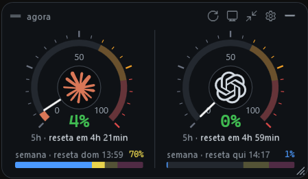
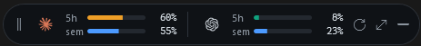
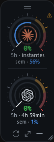
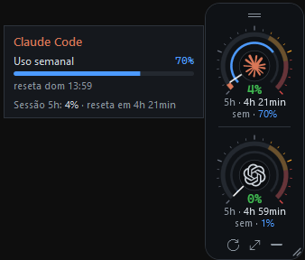
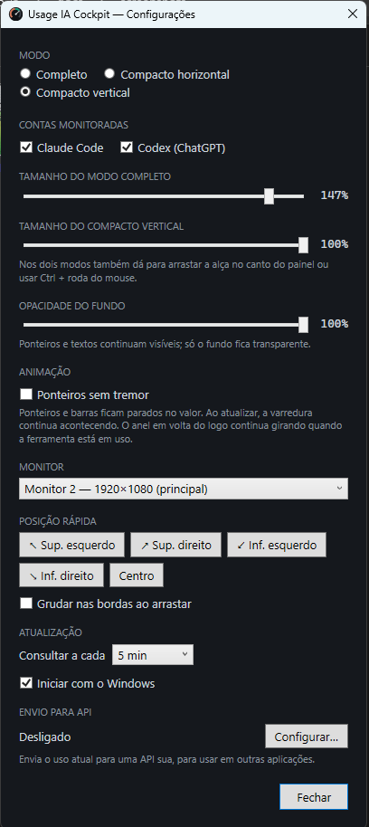
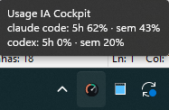

# Usage IA Cockpit

Painel flutuante para Windows que mostra, em tempo real, quanto você já usou dos limites do **Claude Code** e do **Codex** (ChatGPT): a janela de **5 horas** e a cota **semanal** de cada conta.

O painel fica por cima de todas as janelas, em qualquer canto de qualquer monitor, com visual de painel de instrumentos: ponteiros, faixas de alerta e sinais de que as ferramentas estão trabalhando.

<!-- Prints: coloque as imagens em docs/screenshots/ com estes nomes (ou ajuste os caminhos abaixo). -->


---

## Sumário

- [Funcionalidades](#funcionalidades)
- [Modos de exibição](#modos-de-exibição)
- [Requisitos](#requisitos)
- [Instalação](#instalação)
- [Primeiros passos](#primeiros-passos)
- [Como usar](#como-usar)
- [Configurações](#configurações)
- [Como os dados são obtidos](#como-os-dados-são-obtidos)
- [Privacidade](#privacidade)
- [Solução de problemas](#solução-de-problemas)
- [Compilar a partir do código](#compilar-a-partir-do-código)
- [Publicar uma nova versão](#publicar-uma-nova-versão)
- [Estrutura do projeto](#estrutura-do-projeto)
- [Segurança](#segurança)
- [Licença](#licença)

---

## Funcionalidades

- **Uso da sessão de 5 horas e da cota semanal** do Claude Code e do Codex, com o tempo que falta até cada limite resetar.
- **Três modos de exibição:** completo, compacto horizontal e compacto vertical.
- **Sempre visível:** fica por cima das outras janelas e não aparece na barra de tarefas nem no Alt+Tab.
- **Posição livre:** arraste para qualquer lugar. Perto das bordas o painel gruda nelas.
- **Escolha do monitor:** escolha em qual monitor o painel fica. Cada monitor usa a própria escala de DPI. Se o monitor for desconectado, o painel volta para o principal.
- **Fundo com opacidade ajustável** de 0% a 100%. Ponteiros e textos continuam sempre visíveis.
- **Redimensionável:** no modo completo e no compacto vertical.
- **Faixas de uso**, como num conta-giros:
  - abaixo de 60%: cor da marca ou verde;
  - de 60% a 80%: amarelo;
  - de 80% a 100%: vermelho.
- **Sinais visuais:**
  - **App funcionando:** os ponteiros e as pontas das barras tremem levemente o tempo todo.
  - **Ferramenta trabalhando:** um anel colorido gira em volta do logo enquanto o Claude Code ou o Codex está em uso.
  - **Atualização:** ao clicar em atualizar, os ponteiros descem a zero e voltam com os valores novos.
- **Minimizar para a bandeja:** o painel some, e um clique no ícone da bandeja traz ele de volta.
- **Nunca fica em branco:** se uma consulta falhar, o painel mostra a última leitura boa, esmaecida e com um aviso.
- **Leve:** cerca de 2% de um núcleo de CPU em repouso. A renderização usa a placa de vídeo, e as animações param com o painel minimizado.

---

## Modos de exibição

### Completo (cockpit)

Um mostrador com ponteiro por conta para a sessão de 5 horas. Embaixo de cada mostrador ficam o tempo até o reset e uma barra com o uso semanal. Pode ser redimensionado de 55% a 160%.


### Compacto horizontal

Uma faixa fina, com duas barras por conta: sessão de 5h e semana.



### Compacto vertical

Uma coluna estreita com um mini velocímetro da sessão de 5h por conta, boa para a lateral da tela. **Passe o mouse sobre um velocímetro para ver o uso semanal.** Pode ser reduzido de 100% até 60%.




---

## Requisitos

- **Windows 10 (1809 ou mais novo) ou Windows 11**, 64 bits.
- **Login feito em pelo menos uma das ferramentas, na mesma máquina:**
  - **Claude Code:** rode `claude` e faça login com a sua conta Claude (Pro, Max, Team ou Enterprise).
  - **Codex:** rode `codex login` e entre **com a conta do ChatGPT**. O login só com API key não tem limites de plano para mostrar.

Não é preciso instalar o .NET: o executável já inclui tudo o que precisa.

---

## Instalação

### Opção 1: instalador (recomendado)

> **Baixe só pela página de [Releases](../../releases) deste repositório.** Cópias de outros sites podem ter sido alteradas.

1. Baixe o `UsageIACockpit-Setup-<versão>.exe` (cerca de 48 MB) na página de [Releases](../../releases) do repositório.
2. Execute o arquivo. A instalação é feita só para o seu usuário e **não pede permissão de administrador**.
3. Escolha as opções:
   - **Iniciar com o Windows:** o painel abre sozinho quando você entra no Windows.
   - **Criar atalho na área de trabalho.**
4. Ao terminar, o painel abre no canto superior direito do monitor principal.

O app fica instalado em `%LOCALAPPDATA%\Programs\UsageIACockpit` e aparece no menu Iniciar como **Usage IA Cockpit**.

**Para desinstalar:** Configurações do Windows → Aplicativos → Aplicativos instalados → **Usage IA Cockpit** → Desinstalar.

### Opção 2: executável portátil

1. Baixe o `UsageIACockpit-Portable.exe` (cerca de 65 MB) na página de [Releases](../../releases).
2. Coloque o arquivo numa pasta fixa, por exemplo `C:\Ferramentas\UsageIACockpit\`, e execute.

Para abrir junto com o Windows, ative **Iniciar com o Windows** nas configurações do app. Se você mover o exe depois, o app corrige o caminho sozinho na próxima vez que abrir.

### Aviso do Windows SmartScreen

O executável não é assinado digitalmente, então na primeira execução o Windows pode mostrar "O Windows protegeu o computador". Clique em **Mais informações** e depois em **Executar assim mesmo**.

### Conferir o arquivo baixado

Cada release traz um `SHA256SUMS.txt` com o hash dos executáveis. Para conferir se o arquivo baixado é o mesmo que o GitHub gerou, rode no PowerShell, na pasta do download:

```powershell
Get-FileHash .\UsageIACockpit-Setup-<versão>.exe -Algorithm SHA256
```

O valor tem que ser igual ao da linha correspondente no `SHA256SUMS.txt` (o PowerShell mostra em maiúsculas; a comparação não diferencia).

---

## Primeiros passos

1. Abra o app. O painel aparece no canto superior direito com o uso das contas em que você tem login.
2. **Arraste** o painel para onde quiser. A posição fica salva.
3. Clique com o **botão direito** no painel para ver todas as opções: modo, contas, monitor, posição, opacidade e mais.
4. Clique no ícone de **engrenagem** (modo completo) ou use o clique direito → **Configurações…** para ajustar o resto.



---

## Como usar

| Ação | Como fazer |
|---|---|
| Mover | Arraste por qualquer parte do painel. Perto das bordas ele gruda. |
| Trocar de modo | Botão de compactar ou expandir no painel, duplo clique, clique direito ou menu da bandeja |
| Atualizar agora | Botão ⟳ no painel, clique direito ou menu da bandeja |
| Redimensionar | Alça no canto inferior direito, **Ctrl + roda do mouse** ou Configurações |
| Escolher o monitor | Ícone de monitor no painel, clique direito → Monitor, ou Configurações |
| Posições rápidas | Clique direito → Posição: cantos ou centro |
| Ajustar a opacidade | Clique direito → Opacidade do fundo, ou Configurações |
| Escolher as contas | Clique direito → Contas, ou Configurações |
| Minimizar para a bandeja | Botão — no painel ou clique direito |
| Restaurar | Clique no ícone da bandeja |
| Ver detalhes | Passe o mouse sobre um mostrador ou uma barra |
| Sair | Clique direito → Sair, ou menu da bandeja → Sair |

O duplo clique e o botão de compactar alternam entre o modo completo e o **último modo compacto usado**.



### O que cada sinal significa

| Sinal | Significado |
|---|---|
| Ponteiro ou ponta da barra tremendo levemente | O app está funcionando |
| Anel colorido girando em volta do logo | A ferramenta está trabalhando agora |
| Número amarelo ou vermelho | Uso entre 60% e 80%, ou acima de 80% |
| ⚠ ou texto âmbar | A última consulta falhou. O valor mostrado é o último conhecido |
| Conta esmaecida | A leitura tem mais de 15 minutos |

---

## Configurações

Todas as opções ficam na janela **Configurações** e são salvas na hora.

| Opção | Descrição | Padrão |
|---|---|---|
| Modo | Completo, compacto horizontal ou compacto vertical | Completo |
| Contas monitoradas | Claude Code, Codex ou as duas. Pelo menos uma fica marcada | As duas |
| Tamanho do modo completo | De 55% a 160% | 100% |
| Tamanho do compacto vertical | De 60% a 100% | 100% |
| Opacidade do fundo | De 0% (só os instrumentos) a 100% | 85% |
| Monitor | Em qual monitor o painel fica | Principal |
| Grudar nas bordas | Encaixa o painel nas bordas ao arrastar | Ligado |
| Consultar a cada | 2, 5, 10, 15 ou 30 minutos | 5 min |
| Iniciar com o Windows | Abre o app ao entrar no Windows | Desligado |

Arquivos do app em `%APPDATA%\UsageCockpit\`:

| Arquivo | Conteúdo |
|---|---|
| `settings.json` | Configurações |
| `cache.json` | Última leitura boa de cada conta |
| `crash.log` | Erros inesperados, se houver |

---

## Como os dados são obtidos

O app **não pede login nem senha**. Ele usa o login que o Claude Code e o Codex já salvam no seu computador e consulta os mesmos endpoints que essas ferramentas usam para mostrar o próprio uso.

| Conta | Credencial lida | Endpoint consultado |
|---|---|---|
| Claude Code | `%USERPROFILE%\.claude\.credentials.json` | `GET https://api.anthropic.com/api/oauth/usage` |
| Codex | `%USERPROFILE%\.codex\auth.json` | `GET https://chatgpt.com/backend-api/wham/usage` |

- **Credenciais:** os tokens são só lidos. O app nunca renova nem grava as credenciais, para não derrubar a sessão das ferramentas.
- **Frequência:** as consultas acontecem no intervalo configurado e logo depois que uma ferramenta termina de trabalhar, no máximo uma vez por minuto.
- **Limite de consultas:** se o servidor responder "muitas consultas" (HTTP 429), o app respeita o tempo de espera e mostra o último valor salvo.
- **Plano B do Codex:** se a API do Codex falhar, o app lê os limites gravados nos logs locais em `%USERPROFILE%\.codex\sessions`.
- **Detecção de atividade:** o app observa as escritas nos arquivos de conversa em `%USERPROFILE%\.claude\projects` e `%USERPROFILE%\.codex\sessions`.

> **Atenção:** esses endpoints são internos e não documentados pela Anthropic e pela OpenAI. Eles podem mudar sem aviso; se isso acontecer, o app precisa ser atualizado.

---

## Privacidade

- **Nada sai do seu computador**, a não ser as consultas de uso feitas diretamente para a Anthropic e para a OpenAI, com o seu próprio token.
- **Sem servidores próprios:** não há servidor intermediário, telemetria nem coleta de dados.
- **Conteúdo das conversas:** o app não lê o conteúdo das suas conversas. Ele só percebe que os arquivos foram alterados, para saber se a ferramenta está trabalhando, e lê o trecho de limites dos logs do Codex.

---

## Solução de problemas

| Mensagem ou sintoma | Causa e solução |
|---|---|
| **"Token expirado: abra o Claude Code para renovar"** | O token do Claude Code vence depois de algumas horas sem uso. Abra o Claude Code, ou rode qualquer comando nele, para renovar. O painel volta sozinho na próxima consulta. |
| **"Muitas consultas, aguardando"** | O servidor limitou as consultas. O app espera e tenta de novo, mostrando o último valor conhecido enquanto isso. Evite intervalos muito curtos. |
| **"Faça login no Claude Code"** ou **"Faça login no Codex"** | Não foi encontrada credencial nesta máquina. Faça login na ferramenta (veja [Requisitos](#requisitos)). |
| **"Codex sem login do ChatGPT (só API key)"** | O Codex está configurado só com API key. Rode `codex login` e entre com a conta do ChatGPT. |
| O painel sumiu | Ele pode estar minimizado: clique no ícone da bandeja. Se ainda não aparecer, use clique direito no ícone da bandeja → Configurações → Monitor ou uma posição rápida. |
| O painel não abre com o Windows | Desative e ative de novo **Iniciar com o Windows** nas configurações. |
| O app fechou sozinho | Veja `%APPDATA%\UsageCockpit\crash.log` e abra uma issue com o conteúdo. |

---

## Compilar a partir do código

Requer o [.NET SDK 9](https://dotnet.microsoft.com/download) ou mais novo.

```powershell
git clone <url-do-repositório>
cd monitor-uso-ia
dotnet run --project UsageCockpit
```

### Gerar os executáveis

```powershell
.\build.ps1              # dist\UsageIACockpit-Portable.exe (portátil, arquivo único)
.\build.ps1 -Installer   # também gera dist\UsageIACockpit-Setup-<versão>.exe
```

- **Instalador:** o `-Installer` requer o [Inno Setup 6](https://jrsoftware.org/isinfo.php), que pode ser instalado com `winget install JRSoftware.InnoSetup`.
- **Tamanho:** os dois arquivos incluem o .NET, então quem for usar não precisa instalar nada. O instalador (cerca de 48 MB) é o recomendado: o app instalado abre mais rápido e usa menos memória. O portátil (cerca de 65 MB) é um exe único compactado.
- **Modo de verificação:** `UsageIACockpit.exe --snapshot <pasta>` busca os dados reais e salva imagens PNG de todos os modos, sem abrir o painel.

---

## Publicar uma nova versão

1. Atualize a `<Version>` em `UsageCockpit/UsageCockpit.csproj`.
2. Crie e envie uma tag:

   ```powershell
   git tag v0.2.2
   git push origin v0.2.2
   ```

3. O workflow `.github/workflows/release.yml` gera o exe portátil e o instalador e publica os dois na página de Releases, junto com o `SHA256SUMS.txt`. A tag precisa estar no formato `v1.2.3` (sufixo opcional, como `v1.2.3-beta.1`); outro formato faz o build falhar.

---

## Estrutura do projeto

```
UsageCockpit/
  Core/
    Providers.cs        leitura das credenciais e consulta de uso (Claude Code, Codex)
    ActivityMonitor.cs  detecta se a ferramenta está trabalhando agora
    Models.cs           configurações, cache da última leitura
    ViewModels.cs       estado exibido, atualização e textos
    Placement.cs        monitores, posição, DPI e janela sempre visível (Win32)
  Controls/
    Gauge.cs            mostrador com ponteiro, faixas, varredura e anel de atividade
    Instruments.cs      barras do modo completo e do compacto
    Animation.cs        relógio das animações e anel em volta do logo
    Palette.cs          cores, faixas de uso e logos
  Views/                modo completo, compacto horizontal e compacto vertical
  OverlayWindow.*       janela flutuante: arrastar, redimensionar, menus
  SettingsWindow.*      tela de configurações
installer/              script do Inno Setup
tools/make-icon.ps1     gera o ícone do app
build.ps1               gera o exe portátil e o instalador
```

**Tecnologias:** C#, .NET 9 e WPF. A transparência é feita pelo DWM, o que mantém a renderização na placa de vídeo.

---

## Segurança

Encontrou uma vulnerabilidade? Não abra uma issue pública: veja como reportar em privado no [SECURITY.md](SECURITY.md).

---

## Licença

Distribuído sob a [licença MIT](LICENSE). Você pode usar, copiar, modificar e redistribuir o código, inclusive em projetos comerciais, desde que mantenha o aviso de copyright e o texto da licença. O software é fornecido "no estado em que se encontra", sem garantia de nenhum tipo.

---

## Aviso

Projeto independente, sem vínculo com a Anthropic ou a OpenAI. Claude e Claude Code são marcas da Anthropic. ChatGPT, Codex e o logo da OpenAI são marcas da OpenAI.
